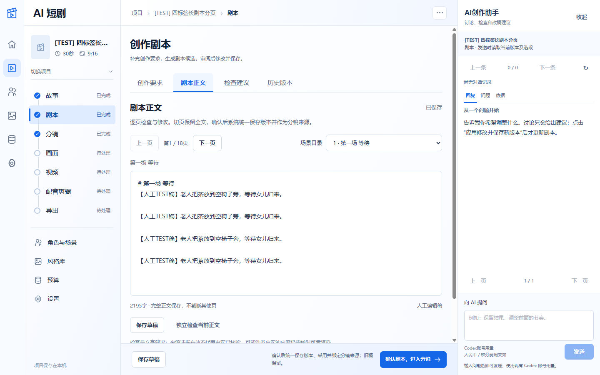
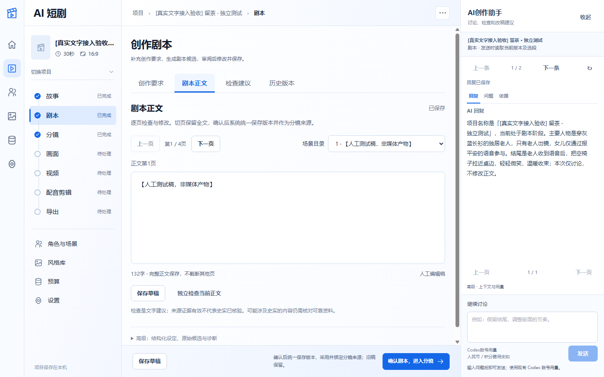

# 分页剧本与AI创作助手：验收记录

2026-11-17（Asia/Shanghai），软件0.10.0。直接修改现有工作台，沿用完整C·调整版左侧结构，不是另建演示页面。软件实现、隔离验证与真实文字验证分开记录；**真实改稿到应用的完整链路本轮未通过真实验收，不能把隔离测试写成真实成功。**

## 基线、启动与保留

已fetch并核对PR [#9](https://github.com/499893181-lang/AI-Drama-Studio/pull/9)仍open、未合并，head为 `b3a683c5b00017fa66b406ece50205cafd61c3b8`。从该完整C版基线建立独立worktree及 `codex/script-assistant-v11-20261117`，不修改旧工作区的未提交内容，不自动合并PR。main新提交仍是研究文档，不能代替包含现有功能的基线。

本机 [剧本工作台](http://127.0.0.1:4320/creative.html?stage=script) 已运行0.10.0。默认启动方式及4317端口仍见README。升级前核对服务PID、路径与无运行中任务，沿用原DATA_DIR、认证和图片上限1。实际4320服务只读检查11页×两尺寸、已有TEST视频播放；570个既有文件逐一比较字节长度及SHA256，全部不变，进程锁除外。原失败图像任务仍failed、result=null；图片上限1、已用1、剩余0没有重置。

## 本轮实际行为

- 中间采用“创作要求／剧本正文／检查建议／历史版本”点击标签；无稿以生成剧本为主动作，有稿统一“确认剧本，进入分镜”。生成成功直接显示可编辑草稿，原始候选保留，尚未采用。
- 按场景边界、段落与阅读容量分页；上一页／下一页、页码及场景目录可点击。UTF-16位置、换行与分隔符无损；编辑一页、切页、保存、刷新、重启后完整正文与结尾保留。分镜有上一镜／下一镜和缩略图，不自动轮播。
- 确认在一次workspace原子写入中保存完整正文、不可变版本、来源和采用指针；`.bak`保持确认前人工稿和旧revision。冲突保留本页文字，提供下载及核对提示，不覆盖磁盘新稿。无变更的有效稿重复确认不额外建版。
- 人物、场景、道具与机器结构在内部整理；普通摘要跟随当前编辑稿，JSON、任务ID及原始诊断收进高级入口。新增用户来源须有输入证据；AI纠正原设定使用新实体版本、保留AI来源与变更说明，历史同一ID+版本不能绑定另一组事实。采用、应用和下游引用均不自动提升为用户事实。
- 生成可串联至多一次新会话独立检查；先持久化检查意图，目标绑定实际候选或未采用的正文快照，不循环改写或重试。检查失败保留候选。正文、要求或来源证据变化使旧检查需复查；单纯确认相同正文不会误使刚完成检查过期。来源字符检查不等于史实核验，缺可靠依据明确待核实。
- 右侧助手读取当前项目、步骤、要求、完整编辑稿、实际编辑版本、已采用版本及精确选段。讨论只写对话；先看修改前后，再点击应用才保存待确认AI版本。应用前重验快照、正文、来源与revision，旧建议不能覆盖新稿；确认后绑定该稿的镜头种子与实体版本，旧分镜及素材需复核。
- 对话按项目保存；完整记录可点击逐条查看，每次模型输入携带本项目最近12轮并说明省略范围。长回复点击分页，输入框固定；折叠和窄屏可用。重复点击、并发、失败、取消和重启不暗中重发。

## 隔离测试及浏览器结果

| 验证 | 结果与证据范围 |
| --- | --- |
| 完整 `node --test tests/*.test.mjs` | **347通过，0失败、0跳过**；保留全部原媒体、费用、任务、来源与备份回归 |
| `node scripts/check-ui.mjs` | 14个前端模块语法、9个真实页面的引用及静态资源检查通过；没有额外打包依赖 |
| 新事务回归 | 10项：候选直接编辑、原子确认与备份、冲突、当前稿不先采用就检查、同稿确认/证据变化的检查绑定、AI来源、一次检查失败停止、显式重试、重启及迟到结果 |
| 助手回归 | 12项：多轮上下文、项目隔离、准确选段、讨论不改稿、显式应用、CAS/Hash、结果篡改、并发/幂等、配置失败、AI实体升版、镜头结构继承与历史版本保留 |
| 分页／验收等待回归 | 3项分页及2项等待回归；正文join逐字一致、场景可定位、只等待本次新消息，不将上一轮成功当成本轮完成 |
| 新剧本Chrome | 11项：四标签、场景目录、多页分别编辑保存、只读历史、当前稿检查、过期、自动显示候选、统一确认、分镜逐镜、分镜编辑前后讨论、重启与隔离 |
| 助手Chrome | 9项：两尺寸展开与固定输入、多轮／选段、前后对照、应用版本、刷新／项目切换、过期拦截、失败、窄屏及重启不重调 |
| 原创作／C版分镜Chrome | 7／13项通过，保留两种预设、用户锁、静态／动态／后期区、审阅、人工版本、拒绝旧图、较多镜头及复核恢复 |
| 原目录实际服务 | 11页×1366×768、1440×900只读通过；570文件Hash、原失败任务及1/1保持，已有15秒TEST导出可解码播放 |

截图和Chrome检查均使用真实应用。隔离runner返回内容明确标为TEST／非真实模型，不调用媒体服务；测试中的FFmpeg素材是软件夹具，不能作为AI生成证据。桌面检查覆盖完整左栏、右助手、中间正文、独立底栏，无覆盖或页面横向溢出；正文无嵌套长滚动。分页、历史、建议均由点击切换。

机器汇总见 [acceptance.json](script-assistant-v11-evidence/acceptance.json)。本机完整日志、个人项目与原始回执仍留在Git忽略目录；公开截图均为独立非个人测试内容。

## 两轮真实Codex文字验收：部分完成

用户明确选择“另验证最多两轮真实Codex文字对话”。本机实际CLI为 `0.167.0-alpha.4.1`，`login status` 返回 `Logged in using ChatGPT`；实际帮助包含既有runner使用的 `exec --json --sandbox read-only --ephemeral --skip-git-repo-check --output-schema`。契约依据为[官方非交互说明](https://developers.openai.com/codex/noninteractive)，复用现有登录，没有新增API Key或切换付费API。

| 实际调用 | 真实结果 |
| --- | --- |
| 第1轮 | 独立测试故事“留茶”，真实 `turn.completed`、退出0。回复准确读取项目名、剧本阶段、老人／女儿关系与温暖结尾；`proposal.kind=none`，原稿没有改变。 |
| 第2轮 | 真实收到 `thread.started`、`turn.started`，输入包含第1轮历史及精确选段“老人把茶杯放到空椅子前”。验收脚本等待时误读第1轮终态，断言失败后关闭测试服务，导致第2轮中断；**无完整回复、无改稿建议、未应用、未返回用量**。 |

这是验收脚本的可避免竞态。已修正为等待不在原消息集合中的本次新ID，并新增两项隔离故障回归。没有发第3轮，也没有更改原中断任务、回执或原失败报告；只追加 [真实调用诊断](script-assistant-v11-evidence/real-diagnosis.json)，记录旧报告Hash、两条回执Hash、实际状态和证据范围。真实验收入口保留同一目录调用记录，再次执行会拒绝重置／自动重试。

第一轮实际用量为input_tokens=27303、output_tokens=465、reasoning_output_tokens=319；第二轮usage未返回，不能写0。人民币和积分费用均未知，不写成免费。原生事件中两轮均未观察到工具调用或媒体事件；这不是read-only能严格限制所有图像工具次数的证明，原自动出图仍关闭。

随后使用拒绝新调用的runner只读重启实际测试目录：恢复1条成功、1条中断记录、原稿及精确选段；另一测试项目没有对话串入。两条任务Hash未变，真实调用总记录仍为2，新增调用0。见 [只读恢复结果](script-assistant-v11-evidence/real-readonly-recovery.json)。

因此：**真实上下文读取与普通讨论已验证；第2轮完整建议→实际点击应用的真实模型链路仍未完成**。其软件链路仅在隔离runner与真实浏览器中通过。若继续真实复验，需要另外明确授权一次文字调用，不能由本轮额度自动补跑。

## 截图

对比使用不同独立测试故事，只比较真实界面，不比较剧情；没有把附件示例内容写入项目。

| 内容 | 截图 |
| --- | --- |
| 原C版剧本 | [改版前](script-assistant-v11-evidence/before-c-script.png) |
| 新版四标签、正文与助手 | [1366×768](script-assistant-v11-evidence/script-1366x768.png) · [1440×900](script-assistant-v11-evidence/script-1440x900.png) |
| 场景与生成候选 | [场景目录](script-assistant-v11-evidence/scene-directory.png) · [生成后直接编辑](script-assistant-v11-evidence/generated-script.png) |
| 隔离建议／应用／过期 | [应用前](script-assistant-v11-evidence/proposal-before-apply.png) · [保存新版本](script-assistant-v11-evidence/applied-version.png) · [旧建议拦截](script-assistant-v11-evidence/stale-proposal.png) |
| 失败／窄屏 | [认证失败夹具](script-assistant-v11-evidence/configuration-failure.png) · [窄屏折叠](script-assistant-v11-evidence/narrow-assistant.png) |
| 真实文字记录 | [真实首轮成功](script-assistant-v11-evidence/real-first-recovered.png) · [真实第二轮中断](script-assistant-v11-evidence/real-interrupted-recovered.png) |

## 保持的能力边界

本轮未提交真实图片、视频、配音、即梦画布或消费确认，不购买额外额度。自动出图保持关闭，原1/1不变；媒体报价、具体范围授权、任务恢复和手工素材流程保留。正式四岗位guard／账本仍not_checked，不能把本次文字检查或UI完成当作正式审稿通过。配音、字幕及首次真实视频验收的既有缺口不在本轮伪造补齐。
