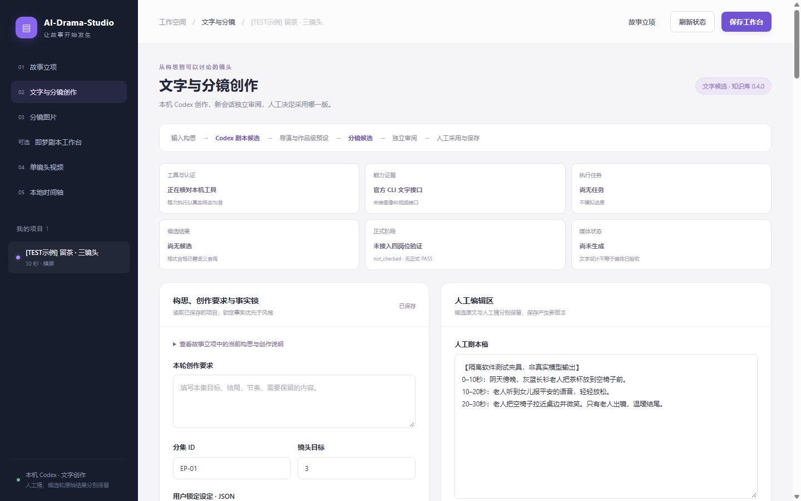
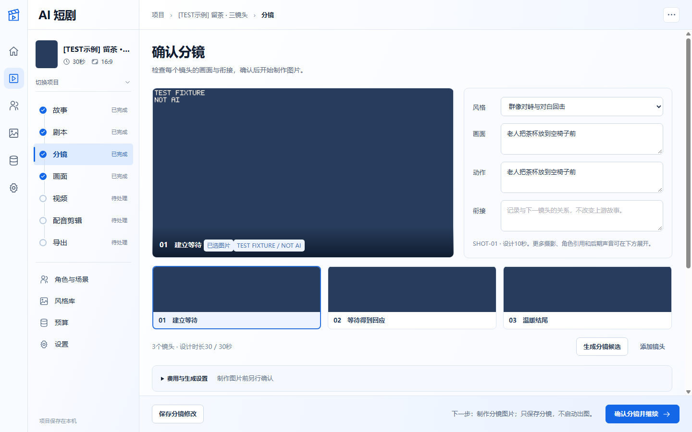

# C·调整版：实际界面验收

2026-11-16，工作台0.9.0。此次直接修改现有应用，不另建演示站。仅使用已有、明确标注TEST FIXTURE / NOT AI的图片和MP4；未启动真实Codex创作、图片、即梦视频、配音、消费确认或收费调用。隔离runner的任务和审阅不代表真实模型结果。

## 基线和保留范围

已核对本机分支、未提交内容和PR依赖，并fetch origin。main仍是研究资料基线，未包含现有完整应用；PR #1–#8尚未合并。因此从PR [#8](https://github.com/499893181-lang/AI-Drama-Studio/pull/8)的 `codex/canvas-video-execution-v09-20261116`、`1900352f1ff4fd6142906d4a89e437bd700b932f` 建立独立worktree和 `codex/ui-c-adjusted-v10-20261116`。此次PR以该功能分支为base，不自动合并。原工作区及其未提交内容保持原处。

4320服务已更新，仍使用原DATA_DIR，没有迁移、复制认证或重建生成历史。实际服务只读验收覆盖七步骤和四资源页；553个既有数据文件逐一比较长度及SHA256，全部不变（进程锁除外）。原自动出图上限1、已提交1、剩余0，原失败任务仍failed、result=null；没有补marker或修改上限。正式guard/账本保持not_checked。

## 验证结果

| 检查 | 实际结果 |
| --- | --- |
| `node --test tests/*.test.mjs` | 320通过，0失败、0跳过；含新增3项workflow回归 |
| `node scripts/check-ui.mjs` | 12个前端模块语法、9个真实页面的引用与资源检查通过；本项目无独立打包依赖 |
| 共享外壳Chrome | 6项：完整双层左侧、原控件代理、禁用条件、直属header动作保留、重复render、重挂保留焦点/选区/滚动 |
| 故事C版Chrome | 5项：新建、默认参数、真实保存、长文本、底部保存后继续与重启恢复 |
| 创作C版Chrome | 13项：分镜大图/编辑/缩略条、两尺寸、同稿继续不重复建版、拒绝旧图如实标识、实体直达、长文本、多镜头、空白/失败/复核及重启 |
| 原创作/图片/可选即梦文字Chrome | 分别7/9/9项通过，保留候选采用、审阅、版本、上传、检查、选用及历史素材 |
| 直连视频/画布视频/时间轴Chrome | 分别8/10/12项通过；含费用与授权门槛、原ID查询、下载恢复、局部任务切换、检查说明离开保护、实际TEST视频播放和本地导出 |
| 媒体和资源C版Chrome | 5组：9页×2尺寸布局、15秒TEST导出实际播放、同风格保存保留手册勾选、预算保存后仍可继续编辑、上游失效及空项目禁用原因 |
| 实际4320服务只读Chrome | 11页×2尺寸通过；实际已有TEST视频1280×720、15秒可播放；原553文件及1/1不变 |

桌面尺寸为1366×768、1440×900，检查窄图标栏/项目面板、顶部、主滚动区、独立底栏边界和页面横向溢出。12镜头只在缩略条自身横向滚动；长文本在编辑区可滚动，底部按钮不被覆盖。浏览器报告未记录未捕获JS异常。

故事“保存故事并继续”先保存后进入剧本；“保存剧本并继续”“确认分镜并继续”复用未变的有效版本，避免仅导航使素材过期。分镜人工修改、刷新、切镜及重启逐字保留；修改输入或风格后，旧分镜、审阅和素材沿现有Hash规则需复核。候选审阅在隔离runner下执行，旧真实调用证据未改。

验收期间还修复：当前拒绝图片不能继续标为已选、资源页保存后主按钮持续禁用、同预设保存清空手册规则、视频主操作跳至错误历史候选、直属header刷新按钮被布局迁移丢失、历史任务切换后底栏仍指旧任务。均由相关浏览器检查覆盖。

原始运行报告保存在本机忽略目录 `tests/.artifacts/`；脱敏汇总、检查条目、截图Hash及保留核对见 [acceptance.json](ui-c-v10-evidence/acceptance.json)。此公开汇总不包含个人项目正文、认证、授权签名、完整原始回执或私有路径。实际原项目截图仅留本机，以下公开截图来自独立TEST项目。

## 前后对比与主要页面

同一独立30秒、三镜头TEST故事，真实v09应用和新版分别载入同一隔离数据。示例文字为人工夹具，蓝色TEST图为既有测试图片，不是新增AI图或附件示意图中的素材。

| 页面 | 改版前 | 改版后 |
| --- | --- | --- |
| 故事 | [截图](ui-c-v10-evidence/before-story.png) | [截图](ui-c-v10-evidence/after-story.png) |
| 剧本 | [截图](ui-c-v10-evidence/before-script.png) | [截图](ui-c-v10-evidence/after-script.png) |
| 分镜 | [截图](ui-c-v10-evidence/before-storyboard.png) | [截图](ui-c-v10-evidence/after-storyboard.png) |
| 画面 | [截图](ui-c-v10-evidence/before-images.png) | [截图](ui-c-v10-evidence/after-images.png) |

其余主要页面：[视频](ui-c-v10-evidence/after-video.png)、[配音剪辑](ui-c-v10-evidence/after-finishing.png)、[导出](ui-c-v10-evidence/after-export.png)、[角色与场景](ui-c-v10-evidence/after-entities.png)、[风格库](ui-c-v10-evidence/after-style.png)、[预算](ui-c-v10-evidence/after-budget.png)、[设置](ui-c-v10-evidence/after-settings.png)。

边界状态：[1366故事长文本](ui-c-v10-evidence/story-1366x768.png)、[1366分镜布局](ui-c-v10-evidence/storyboard-1366x768.png)、[空分镜](ui-c-v10-evidence/empty-storyboard.png)、[图片读取失败](ui-c-v10-evidence/image-read-failure.png)、[重启后需复核](ui-c-v10-evidence/restored-needs-review.png)、[多镜头](ui-c-v10-evidence/many-shots.png)。

## 入口与能力边界

本机 [工作台](http://127.0.0.1:4320/) · [分镜](http://127.0.0.1:4320/creative.html?stage=storyboard) · [新故事](http://127.0.0.1:4320/?new=1)。各步骤通过左侧保持当前projectId；首次启动仍按README默认4317。GitHub托管源代码和截图，localhost地址需在运行软件的电脑打开。

本轮没有重新验收真实生成渠道：自动出图仍关闭；即梦文字费用缺依据时仍待确认；视频仍受具体任务报价与本人签名授权控制。配音、字幕编辑、完整成片内容验收和正式四岗位guard尚未接通。配音剪辑页提供已有视频的排序、音轨设置与本地拼接，不把这些显示成配音完成。步骤“已完成”只表示当前已保存资料、有效人工选用或实际本地导出，不代表正式审稿PASS。
